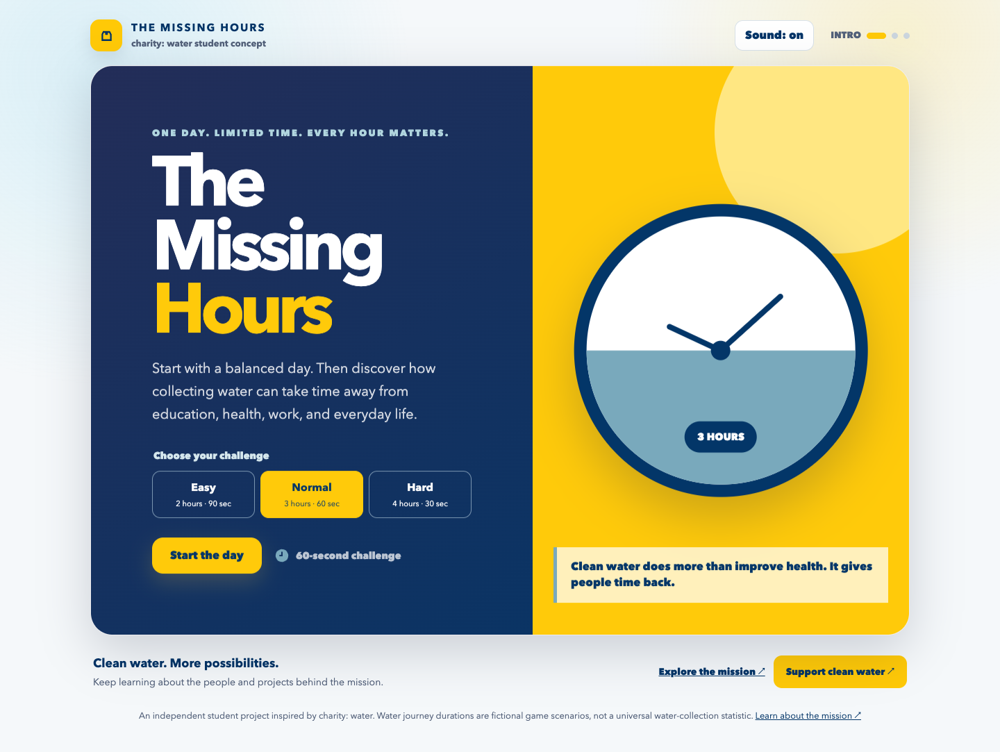

# The Missing Hours

**One day. Limited time. Every hour matters.**

A completed charity: water-inspired awareness game for Web Development Project 6, continuing the Project 5 prototype. Built with HTML, CSS, and vanilla JavaScript.

**[Play the live game](https://playlist0726-code.github.io/the-missing-hours/)**



## How to play

1. Choose a difficulty, then select **Start the day** to review a balanced 24-hour schedule.
2. **Lock my schedule** begins the water journey and timer.
3. Use **−** to remove an activity hour. A square disappears and your category score changes. Use **+** to restore an hour.
4. Allocate the required number of hours, then select **See my impact**.
5. Review your choices and impact, explore charity: water's mission, or play again with another difficulty.

| Mode | Journey hours | Timer |
| --- | ---: | ---: |
| Easy | 2 | 90 seconds |
| Normal | 3 | 60 seconds |
| Hard | 4 | 30 seconds |

If time expires, existing choices are preserved and remaining cuts are allocated in this order: Sleep, Class, Study, Work, Meals, Friends. The deadline is checked on every input as well as timer ticks. Reset clears the timer, scores, tokens, milestones, and result state. The selected difficulty and sound preference remain selected during the session.

## Project 6 requirements

- Three difficulty modes change both the goal and pace.
- Activity hour tokens are actual DOM nodes, removed on cuts and re-created on undo.
- Footer links to the official charity: water website and donation page.
- Proxima Nova/Avenir font stack, with a bundled open-source Nunito Sans fallback for a similar geometric sans-serif appearance across devices.
- Responsive layouts, labeled controls, keyboard focus, live announcements, and reduced-motion support.
- **Sound LevelUp (+10):** downloaded local WAV clips play on choices and completion. Sound can be muted. Audio playback failure does not prevent play.
- **Milestone LevelUp (+10):** an array of messages and progress conditionals trigger at 50% and 100% of the goal, once per round. Undo does not repeatedly trigger awards.

The optional AI-feedback route informed three final improvements: make the time tradeoff visible with disappearing tokens, add progress milestones, and connect the final experience to the mission through a donation link. No human playtest feedback is claimed.

## Rules and scoring

| Activity | Starting hours | Minimum hours | Category | Points lost per removed hour |
| --- | ---: | ---: | --- | ---: |
| Sleep | 8 | 5 | Health | 12 |
| Class | 5 | 2 | Education | 13 |
| Study | 3 | 0 | Education | 10 |
| Work | 4 | 1 | Life | 9 |
| Meals | 2 | 1 | Health | 10 |
| Friends | 2 | 0 | Life | 7 |

Each category starts at 100; the total Impact Score is out of 300. Scores and scenario durations are fictional game design choices, not measures of real wellbeing or universal water-collection statistics. There is no perfect choice: essential needs compete for limited time. This is an independent student project, not an official charity: water product.

## Run and test

No dependency installation or build step is required.

```sh
python3 -m http.server 8000
```

Open `http://localhost:8000/`. ES modules require an HTTP server.

```sh
npm test
```

Seven automated rule tests cover scoring, limits, restoration, timeout, formatting, and all difficulty goals. GitHub Actions runs them on pushes and pull requests. See [QA notes](docs/QA.md) for browser checks.

## Files

- `index.html`: game screens, difficulty selection, mission links.
- `styles.css`: responsive layout and branding.
- `game.js`: pure scoring, difficulty, and timeout rules.
- `app.js`: DOM updates, timer, sound, milestones, and focus.
- `assets/`: local fonts, audio, and licensing notes.
- `tests/`: automated game-rule tests.
- `docs/`: screenshots and QA notes.

## Publishing

GitHub Pages serves the root of the `main` branch. The live URL above is the evaluator link. Private reflection answers and the completed submission PDF are delivered separately and are not committed to this public repository.

## Credits

AI assisted with implementation, debugging, documentation, and validation. The clock is drawn with CSS.

Brand reference: [official charity: water frontend typography guidance](https://charitywater.github.io/cw-puddle/guidelines/). Typography fallback: [Nunito Sans](https://github.com/google/fonts/tree/main/ofl/nunitosans), included under the SIL Open Font License. Sounds: [Mixkit free video game sound effects](https://mixkit.co/free-sound-effects/video-game/), included as part of this game under the [Mixkit Sound Effects Free License](https://mixkit.co/license/#sfxFree); see [asset credits](assets/CREDITS.md).
