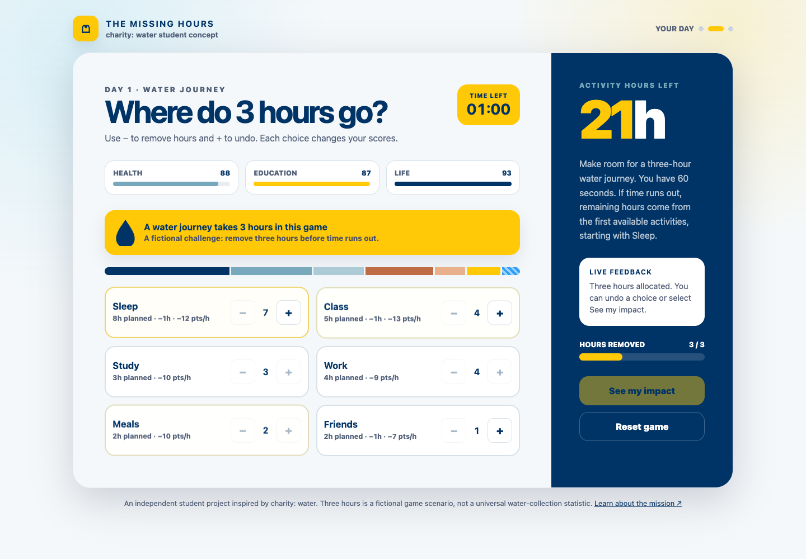

# The Missing Hours

**One day. Limited time. Every hour matters.**

A responsive awareness game inspired by charity: water, created for Web Development Project 5. Built with HTML, CSS, and vanilla JavaScript; no framework, installation, account, or backend required to play.

**[Play the live game](https://playlist0726-code.github.io/the-missing-hours/)**



## How to play

1. Select **Start the day** to review a balanced 24-hour schedule.
2. Select **Lock my schedule** to begin a fictional three-hour water-collection challenge and a 60-second timer.
3. Use **−** to cut an hour from an activity. **+** restores a previously removed hour.
4. Remove exactly three hours and select **See my impact**. Each cut changes Health, Education, or Life scores immediately.
5. Review your Impact Score and the activities that lost time. Use **Play again** or **Reset game** to restore everything.

There is no traditional loser. Completing the challenge earns a Time Saver badge and a brief confetti celebration, including when time expires. Reduced-motion preferences suppress confetti.

If time runs out, the game preserves your choices and assigns the remaining cuts in this order: Sleep, Class, Study, Work, Meals, Friends. A deadline-based timer prevents browser throttling from extending the round.

## Rules and scoring

| Activity | Starting hours | Minimum hours | Category | Points lost per removed hour |
| --- | ---: | ---: | --- | ---: |
| Sleep | 8 | 5 | Health | 12 |
| Class | 5 | 2 | Education | 13 |
| Study | 3 | 0 | Education | 10 |
| Work | 4 | 1 | Life | 9 |
| Meals | 2 | 1 | Health | 10 |
| Friends | 2 | 0 | Life | 7 |

Each category starts at 100. The Impact Score is the sum, out of 300. All rules, minimums, and scores are game design choices. They do not quantify real wellbeing. The “biggest time tradeoff” reflects hours removed per category and handles ties.

The three-hour journey is a fictional scenario, not a universal statistic. This independent educational project does not claim to simulate any person's or community's lived experience, and is not an official charity: water product.

## Project 5 requirements

- Interactive HTML/CSS/JavaScript game with a 60-second timer.
- Live score tracking, feedback, and a visual schedule.
- Responsive desktop, tablet, and mobile layouts.
- **Challenge LevelUp:** water journey cuts reduce category scores.
- **Reset LevelUp:** Reset game and Play again clear the timer, scores, cuts, progress, and screen state.
- **Celebration LevelUp:** Time Saver badge and confetti on completion.
- Public GitHub repository and GitHub Pages deployment.
- Submission PDF and personal reflection drafts are delivered separately and are excluded from this public repository.

## Run locally

Use Python 3 to serve the project folder:

```sh
python3 -m http.server 8000
```

Open `http://localhost:8000/`. A local server is needed because the JavaScript uses native modules.

## Test

With Node.js 18 or newer:

```sh
npm test
```

There are no npm dependencies. GitHub Actions runs the same six rule tests on pushes and pull requests. See [QA notes](docs/QA.md) for browser verification.

## Files

- `index.html`: semantic interface and all three screens.
- `styles.css`: branding, layout, responsive styles, and reduced-motion support.
- `game.js`: scoring, activity limits, undo, and timeout rules.
- `app.js`: DOM updates, focus, timer, reset, and confetti.
- `tests/game.test.js`: rule and boundary tests.
- `docs/`: gameplay screenshots and QA notes.

## GitHub Pages

This site serves the root of the `main` branch through GitHub Pages. To deploy a copy, push these files to your own repository, then select **Settings → Pages → Deploy from a branch → main → / (root)**. Update the live URLs in this README and the submission document for your repository.

## Design and acknowledgments

This prototype continues the earlier **The Missing Hours** Project 4 concept. AI assisted with implementation, debugging, documentation, and validation. Colors are inspired by charity: water's published palette (yellow `#FFC907`, navy `#003366`, blue-gray `#77A8BB`). The clock illustration is made with CSS; the game uses no third-party photography or external font requests.

Brand references: [charity: water media resources](https://www.charitywater.org/about/media), [Brand Usage Guide](https://assets.ctfassets.net/2w85ks0ylymt/2UwAu4A13yqcXT708Fe8c3/2720347e0f034232827402376440aa7a/cw_Brand_Usage_Guide.pdf). Learn about the mission at [charitywater.org](https://www.charitywater.org/).
